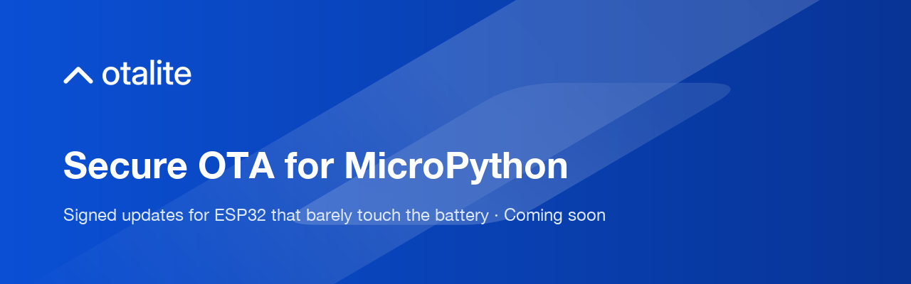

  

## Secure OTA updates for MicroPython on ESP32

otalite is a managed over-the-air update service for MicroPython devices on the ESP32 family, built around battery life and security. It's built by a DIY enthusiast, for makers and small teams taking their ideas from the workbench into production.

**Status: coming soon.** Nothing here is available to use or buy yet. Our code is private while we build.

What we're building:

- **Signed releases**: Ed25519-signed manifests, verified on the device before anything installs, with automatic rollback.
- **Low-power check-ins**: a few hundred encrypted bytes over CoAP + OSCORE, designed around deep sleep.
- **Battery you can see before you ship**: simulate a release until the battery is empty, set a battery-life target, and get alerted before a release misses it.
- **Staged rollouts**: waves, update windows, passkey approvals and automatic pause.
- **Insights**: device issue reports, release impact, and package and security advisories.
- **Built for your coding agent**: prompts and an MCP server so Claude Code, Cursor and Copilot can add otalite to your MicroPython code.

[Website](https://www.otalite.com) · [Roadmap](https://www.otalite.com/roadmap) · [Register interest](https://www.otalite.com/interest) · [Discord](https://discord.gg/KjGpjgRCuY)

Security issues: please email sales@otalite.com rather than opening a public issue.
